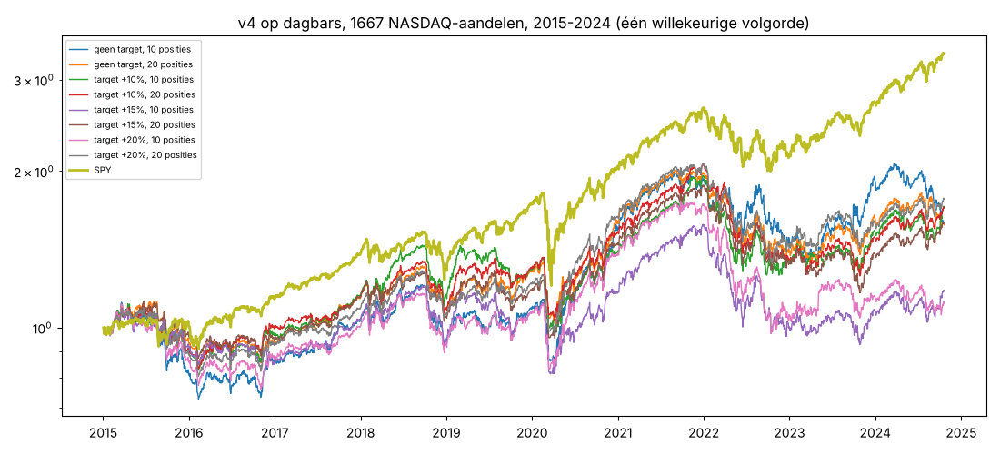

# Jouw regels op dagbars, NASDAQ (1667 aandelen), 2015-01-01 .. 2024-10-21

## 1. Alle trades (alsof je elk signaal kon nemen)

| v4 dag, 1 BUY/2 weken   |   trades | winrate   | gem. winst   | gem. verlies   | gem. trade   | mediaan trade   |   PF | target geraakt   |   hold (dagen) | beste 1% trades = % van winst   |
|:------------------------|---------:|:----------|:-------------|:---------------|:-------------|:----------------|-----:|:-----------------|---------------:|:--------------------------------|
| geen target             |     4447 | 43%       | 14.2%        | -7.9%          | 1.63%        | -1.85%          | 1.36 | 0%               |             32 | 76%                             |
| target +10%             |     5098 | 51%       | 9.2%         | -8.1%          | 0.75%        | 0.45%           | 1.19 | 47%              |             18 | 23%                             |
| target +15%             |     4802 | 46%       | 11.5%        | -8.0%          | 0.96%        | -1.20%          | 1.22 | 33%              |             22 | 27%                             |
| target +20%             |     4666 | 44%       | 12.7%        | -7.9%          | 1.22%        | -1.57%          | 1.28 | 24%              |             25 | 25%                             |

## 2. Een echte rekening

| systeem                                                    | CAGR   | max DD   |   Sharpe |   MAR |
|:-----------------------------------------------------------|:-------|:---------|---------:|------:|
| geen target, max 10 posities                               | 4.7%   | -36.0%   |     0.25 |  0.14 |
| geen target, max 20 posities                               | 4.8%   | -32.2%   |     0.27 |  0.16 |
| target +10%, max 10 posities                               | 4.8%   | -36.2%   |     0.26 |  0.14 |
| target +10%, max 20 posities                               | 5.1%   | -38.2%   |     0.29 |  0.14 |
| target +15%, max 10 posities                               | 2.6%   | -43.0%   |     0.14 |  0.06 |
| target +15%, max 20 posities                               | 4.3%   | -40.6%   |     0.24 |  0.11 |
| target +20%, max 10 posities                               | 3.9%   | -37.1%   |     0.21 |  0.11 |
| target +20%, max 20 posities                               | 5.4%   | -34.2%   |     0.31 |  0.16 |
| SPY kopen en vasthouden                                    | 13.2%  | -33.7%   |     0.69 |  0.39 |

## Wat dit zegt

- **Elke variant blijft ver onder SPY**: 2,6–5,4% per jaar tegen 13,2%, met grotere dalingen (−32 tot −43% vs −34%).
  Dat geldt met 10 en met 20 posities.
- **De target verandert vooral de winrate, niet het rendement.** +10% tilt de winrate van 43% naar 51% en maakt de
  mediane trade positief (+0,45% vs −1,85%), maar de rekening doet ~5% per jaar, net als zonder target. +15% is het
  slechtst (2,6% met 10 posities); de verschillen tussen de targets zijn klein en wisselend, dus ruis.
- Zonder target komt 76% van de winst uit de beste 1% van de trades (echte uitschieters: ENPH 2019, VKTX 2023, TSLA
  2019, FSLY 2020); met een target valt dat naar 23–27%: de target kapt de grote winnaars af.
- Datakwaliteit: de dagdata van kleine NASDAQ-aandelen bevatten fouten (704 aandeel-dagen met > +100%, max +416.567%,
  door reverse splits/pennystocks). Een "gemiddeld aandeel"-benchmark is daardoor onbruikbaar en is weggelaten
  (met dagbewegingen begrensd op ±50%: 9,5%/jaar; het mediane aandeel: −12,8%/jaar). De strategie zelf wordt er
  nauwelijks door geraakt: 1 van de 4.447 trades bevat zo'n sprong (liquiditeitsvloer koers ≥ $5, ≥ $5 mln/dag).
- Survivorship: alleen aandelen die in 2026 nog genoteerd zijn; dat maakt de cijfers eerder te mooi dan te slecht.
