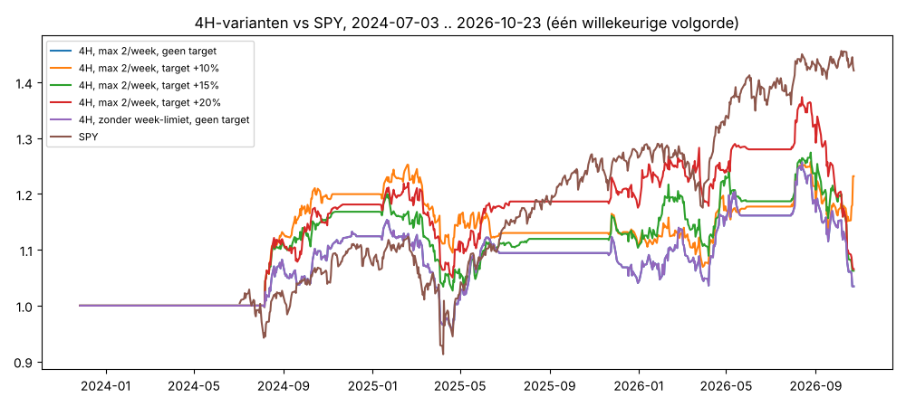

# v4-breakout op 4H — jouw regels getest

Periode 2024-07-03 .. 2026-10-23 (120 weken), 337 ontwikkelaandelen (geen holdout), Yahoo-uurdata gegroepeerd tot 4H. Kosten 0,1%/kant + 0,1% slippage op instappen, max 10 posities van 10%, lege kas 0%.

| systeem                             | trades   | trades/week (alle aandelen)   | winrate   | gem. winst   | gem. verlies   | gem. trade   | hold (4H-bars)   | target geraakt   | CAGR   | max DD   |   Sharpe |   MAR |
|:------------------------------------|:---------|:------------------------------|:----------|:-------------|:---------------|:-------------|:-----------------|:-----------------|:-------|:---------|---------:|------:|
| 4H, max 2/week, geen target         | 1539.0   | 12.8                          | 37%       | 9.7%         | -4.6%          | 0.65%        | 26.1             | 0%               | -0.3%  | -19.1%   |     0.02 | -0.01 |
| 4H, max 2/week, target +10%         | 1725.0   | 14.3                          | 40%       | 7.4%         | -4.6%          | 0.21%        | 19.0             | 27%              | 3.2%   | -16.3%   |     0.34 |  0.21 |
| 4H, max 2/week, target +15%         | 1627.0   | 13.5                          | 37%       | 8.1%         | -4.6%          | 0.16%        | 22.1             | 16%              | 3.3%   | -15.7%   |     0.35 |  0.23 |
| 4H, max 2/week, target +20%         | 1599.0   | 13.3                          | 37%       | 9.0%         | -4.6%          | 0.39%        | 23.2             | 12%              | 2.9%   | -17.7%   |     0.31 |  0.19 |
| 4H, zonder week-limiet, geen target | 1539.0   | 12.8                          | 37%       | 9.7%         | -4.6%          | 0.65%        | 26.1             | 0%               | -0.3%  | -19.1%   |     0.02 | -0.01 |
| v4 op dagbars (met model)           | 842.0    | –                             | 40%       | 14.9%        | -6.9%          | 1.92%        | –                | –                | 5.2%   | -22.9%   |     0.4  |  0.23 |
| SPY kopen en vasthouden             | –        | –                             | –         | –            | –              | –            | –                | –                | 16.5%  | -18.8%   |     1.02 |  0.88 |

## Wat dit zegt

- **4H is niet beter dan dagbars, en beide liggen ver onder SPY** in deze periode (juli 2024 → okt 2026, 2,3 jaar):
  beste 4H-variant CAGR 3,3% · v4 op dagbars 5,2% · SPY 16,5% (met een kleinere max. daling dan alle varianten).
- **Een winst-target van +10–15% helpt t.o.v. geen target** (CAGR 3,2–3,3% vs −0,3%; max DD −16% vs −19%). De drie
  targets liggen dicht bij elkaar, dus het exacte getal doet er weinig toe.
- **De limiet van 2 BUY's per week wordt nooit geraakt**: een trade duurt ~13 handelsdagen en zolang die loopt komt
  er op dat aandeel geen nieuwe BUY. De variant zonder limiet is identiek.
- **Waarom de gemiddelde trade positief is en de portefeuille niet** (zonder target): de mediane trade is −2,1%; de
  beste 1% van de trades levert 104% van de totale winst. Met 10 posities hangt het rendement dus af van of je die paar
  uitschieters toevallig hebt (−1,1% tot +6,7% totaal, alleen door de volgorde van gelijktijdige signalen).
- Kanttekeningen: slechts 2,3 jaar (Yahoo heeft geen oudere uurdata), een sterk stijgende markt, en het
  kwaliteitsmodel van v4 zit niet in de 4H-versie.
