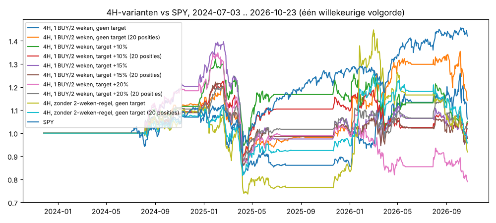

# v4-breakout op 4H — jouw regels getest

Periode 2024-07-03 .. 2026-10-23 (120 weken), 1795 NASDAQ-aandelen, Yahoo-uurdata gegroepeerd tot 4H. Kosten 0,1%/kant + 0,1% slippage op instappen, max 10 posities van 10%, lege kas 0%.

| systeem                                             | trades   | trades/week (alle aandelen)   | mediaan trade   | PF   | beste 1% = % van winst   | winrate   | gem. winst   | gem. verlies   | gem. trade   | hold (4H-bars)   | target geraakt   | CAGR   | max DD   |   Sharpe |   MAR |
|:----------------------------------------------------|:---------|:------------------------------|:----------------|:-----|:-------------------------|:----------|:-------------|:---------------|:-------------|:-----------------|:-----------------|:-------|:---------|---------:|------:|
| 4H, 1 BUY/2 weken, geen target                      | 5221.0   | 43.4                          | -3.58%          | 0.99 | -2055%                   | 33%       | 15.4%        | -7.9%          | -0.07%       | 24.2             | 0%               | -1.7%  | -31.8%   |    -0.02 | -0.02 |
| 4H, 1 BUY/2 weken, geen target (20 posities)        | 5221.0   | 43.4                          | -3.58%          | 0.99 | -2055%                   | 33%       | 15.4%        | -7.9%          | -0.07%       | 24.2             | 0%               | 1.5%   | -25.7%   |     0.15 |  0.07 |
| 4H, 1 BUY/2 weken, target +10%                      | 5738.0   | 47.7                          | -1.56%          | 0.97 | -166%                    | 46%       | 9.2%         | -8.1%          | -0.13%       | 15.2             | 41%              | 0.2%   | -33.3%   |     0.09 |  0.03 |
| 4H, 1 BUY/2 weken, target +10% (20 posities)        | 5738.0   | 47.7                          | -1.56%          | 0.97 | -166%                    | 46%       | 9.2%         | -8.1%          | -0.13%       | 15.2             | 41%              | 0.5%   | -29.2%   |     0.1  |  0.02 |
| 4H, 1 BUY/2 weken, target +15%                      | 5584.0   | 46.4                          | -2.94%          | 0.96 | -145%                    | 39%       | 11.9%        | -8.0%          | -0.18%       | 18.0             | 29%              | 0.6%   | -32.4%   |     0.12 |  0.04 |
| 4H, 1 BUY/2 weken, target +15% (20 posities)        | 5584.0   | 46.4                          | -2.94%          | 0.96 | -145%                    | 39%       | 11.9%        | -8.0%          | -0.18%       | 18.0             | 29%              | 0.6%   | -27.9%   |     0.11 |  0.03 |
| 4H, 1 BUY/2 weken, target +20%                      | 5488.0   | 45.6                          | -3.34%          | 0.96 | -172%                    | 36%       | 13.5%        | -8.0%          | -0.18%       | 19.8             | 22%              | -2.9%  | -35.2%   |    -0.09 | -0.04 |
| 4H, 1 BUY/2 weken, target +20% (20 posities)        | 5488.0   | 45.6                          | -3.34%          | 0.96 | -172%                    | 36%       | 13.5%        | -8.0%          | -0.18%       | 19.8             | 22%              | -1.8%  | -28.8%   |    -0.07 | -0.05 |
| 4H, zonder 2-weken-regel, geen target               | 5255.0   | 43.7                          | -3.62%          | 0.98 | -1038%                   | 33%       | 15.4%        | -7.9%          | -0.13%       | 24.2             | 0%               | -7.6%  | -39.0%   |    -0.31 | -0.17 |
| 4H, zonder 2-weken-regel, geen target (20 posities) | 5255.0   | 43.7                          | -3.62%          | 0.98 | -1038%                   | 33%       | 15.4%        | -7.9%          | -0.13%       | 24.2             | 0%               | -1.4%  | -29.0%   |    -0.02 | -0.05 |
| SPY kopen en vasthouden                             | –        | –                             | –               | –    | –                        | –         | –            | –              | –            | –                | –                | 16.5%  | -18.8%   |     1.02 |  0.88 |

