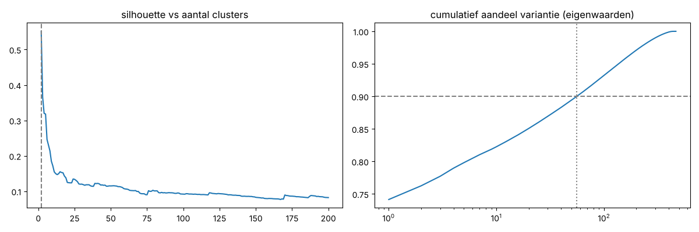
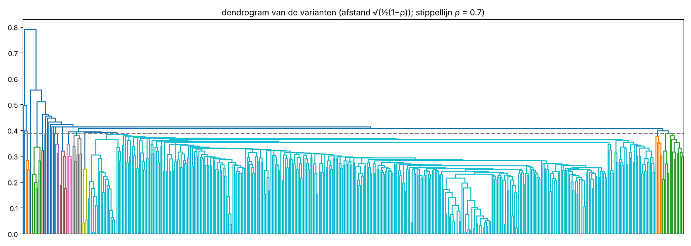

# Overfitting-meting — stap 1: trials-inventaris, N en N_eff

Alleen meten: geen strategieregel is veranderd, niets is opnieuw gekozen of getuned. Varianten met een walk-forward-model bouwen dat model precies zoals de variant het definieerde (jaarlijkse refits).

## Gemeenschappelijke basis

- universum: DEV-U, 253 ontwikkeltickers (bevat alle universums van E0–E60; geen v4- of v5-holdoutticker)
- periode: 2015-01-01 .. 2024-10-21 (2467 handelsdagen), data afgekapt vóór de v4-tijdholdout
- portefeuille: max 10 posities van 10%, signalen op dezelfde dag in één vaste willekeurige volgorde (seed 0), lege slots 0% tenzij de variant zelf parkeert; kosten 0,1% per kant op elke fill
- dagrendementen op portefeuilleniveau, één kolom per variant

## Aantallen

| | aantal |
|---|---|
| rijen in trials_inventory.csv | 562 |
| **getelde trials in de v3/v4-lijn (E0–E60, swing4, swing5) = N** | **499** |
|   waarvan E-experimenten | 388 |
|   waarvan swing4-ronde (fase 1–2, gelogd) | 102 |
|   waarvan swing5 fase 0 | 9 |
|   waarvan placeholder voor een grid zonder vastgelegde punten | 3 |
| gereconstrueerd met een dagreeks | 467 (94%) |
| niet gereconstrueerd | 32 |
| niet geteld: herbeoordelingen, Pine, R1–R7, dubbele | 31 |
| buiten de lijn (scanner-voorloper uit git, 20/21-strategie), apart gelijst | 32 |

Controle tegen de totalen die het log zelf noemt: E0–E19 hier 213 trials (log: "~150 variants"), E0–E33 hier 300 (log: "~35 families and ~250 variants"). De telling hier is minstens zo hoog als het log. 
Strengste telling (log-totaal voor E0–E33 als dat hoger is): **N_streng = 499**. Met de scanner-voorloper erbij: 525.

## Effectief aantal onafhankelijke trials (op de gereconstrueerde reeksen)

Correlatiematrix van 467 dagreeksen (0 zonder enige trade weggelaten). Gemiddelde paarsgewijze correlatie ρ̄ = 0.72.

| methode | N_eff |
|---|---|
| **ONC** (López de Prado & Lewis 2019): k-means op de afstanden √(½(1−ρ)), k gekozen op gemiddelde/spreiding van de silhouette, zwakke clusters recursief opnieuw geclusterd | **2** |
| hiërarchisch (average linkage), k met de hoogste gemiddelde silhouette — gedegenereerd: splitst alleen de 5 short-varianten af (ρ < 0 met de rest) | 2 |
| zelfde boom, afgesneden waar clusters onderling ρ ≥ 0.95 hebben | 414 |
| zelfde boom, afgesneden waar clusters onderling ρ ≥ 0.9 hebben | 359 |
| zelfde boom, afgesneden waar clusters onderling ρ ≥ 0.8 hebben | 93 |
| zelfde boom, afgesneden waar clusters onderling ρ ≥ 0.7 hebben | 22 |
| zelfde boom, afgesneden waar clusters onderling ρ ≥ 0.5 hebben | 4 |
| eigenwaarden van de correlatiematrix die samen 90% van de variantie verklaren | **56** |
| ρ̄ + (1 − ρ̄)·N (Bailey e.a., gemiddelde-correlatie-benadering) | 131 |

Controle zonder marktbèta (elke reeks min β·SPY; β mediaan 0.55, 5–95%: 0.41–0.67): ρ̄ = 0.59, ONC 2, boom-snede ρ ≥ 0.8: 264, eigenwaarden 90%: 108.

**Lezing.** De clustermethoden die zelf het aantal clusters kiezen (ONC en de silhouette-snede) vinden steeds maar twee brede families, ook zonder de marktbèta. Dat zegt dat er geen scherp gescheiden groepen zijn. Het zegt niet dat er maar twee onafhankelijke pogingen waren: binnen de grote familie correleren de varianten gemiddeld ρ ≈ 0,7 en niet ~1, dus elke variant voegt nog eigen ruis toe waarop gekozen kon worden. Met N_eff = 2 zou de DSR veel te mild zijn. De maten die die spreiding wél meetellen liggen tussen 22 (snede ρ ≥ 0.7) en 93 (snede ρ ≥ 0.8), met 56 eigenwaarden voor 90% van de variantie (108 zonder marktbèta).

**Voorstel voor stap 2.** N_eff = 93 (hiërarchische boom, varianten met ρ ≥ 0.8 tellen als één trial), met als controle de eigenwaardentelling (56); de DSR rapporteer ik daarnaast met de ruwe N = 499 (streng) en, ter vergelijking, met de clustertelling 2 (mild).

Niet-gereconstrueerde varianten zitten niet in de matrix. Bijna allemaal zijn het buren van wel gereconstrueerde varianten (andere slots, kosten, of grids rond een vastgelegd punt), dus ze vallen vrijwel zeker in bestaande clusters; als bovengrens schaal ik N_eff mee met N: 2 × 499/467 = 2.

## De clusters (ONC)

| cluster | varianten | voorbeelden |
|---|---|---|
| 1 | 420 | E2.ema10_50, E3.don55_20_3.0, E3.don20_40_4.0, E3.don20_20_4.0, E3.don16_20_4.0, E3.don24_20_4.0 … |
| 2 | 47 | E0.v0, E1.rsi2_10_sma5, E1.rsi2_20_sma10, E2.ema20_50_t3, E3.don20_40_None, E4.regime200 … |

Waar de eindsystemen zitten: v1 = E3.don20_20_4.0 (cluster 1); v2 = E7.ibs0.7 (cluster 1); v3_engine = E18.keep0.75 (cluster 1); v3.1_engine = E48.park_spy200 (cluster 1); v2_lab = S4.1 (cluster – niet geteld, duplicaat); v3 = S4.2 (cluster – niet geteld, duplicaat); v4 = S4.79 (cluster 1); v4_park = S4.103 (cluster 1); v4_complete = S5.1 (cluster 1)

## Niet gereconstrueerd (getelde trials)

| reden | aantal | ids |
|---|---|---|
| andere kosten dan de gemeenschappelijke basis (0.1%/kant) | 2 | E20.v3_cost0.25, E20.v2_cost0.25 |
| gridpunten niet vastgelegd in het log | 2 | E1.grid, E3.grid |
| hertuningsgrid niet vastgelegd | 1 | E7.grid |
| meer dan 10 posities: buiten de basis 'max 10 posities' | 24 | E46.n20_t3.0_K15, E46.n20_t3.0_K20, E46.n20_t4.0_K15, E46.n20_t4.0_K20, E46.n20_t5.0_K15, E46.n20_t5.0_K20, E46.n30_t3.0_K15, E46.n30_t3.0_K20 … |
| welke 6 features niet vastgelegd | 2 | E17.v1meta_6feat_1, E17.v1meta_6feat_2 |
| welke pullback-parameters niet vastgelegd | 1 | E9.pb+v2 |

Gereconstrueerd met deels afgeleide parameters (de tekst geeft geen volledige specificatie): 36 — E4.regime_rs, E9.pb_w5_rsi10, E9.pb_w5_rsi20, E9.pb_w5_rsi30, E9.pb_w10_rsi10, E9.pb_w10_rsi20, E9.pb_w10_rsi30, E9.pb_w20_rsi10, E9.pb_w20_rsi20, E9.pb_w20_rsi30, E13.tight4_2.5, E13.tight6_2.5, E13.tight6_3.0, E13.tight8_3.0, E14.parts10_20_55, E14.parts20_40, E14.blend10_20_55, E14.blend10_20_40, E14.blend15_20_30, E14.blend20_55, E14.blend10_20, E14.blend10_20_55_t3.0, E14.blend10_20_55_t5.0, E18.4feat_keep0.6, E18.4feat_keep0.75, E18.4feat_keep0.9, E25.mr20, E26.w4_4_notrail, E26.w10_5_t6, E28.feat_all5, E28.feat_all5w, E32.trailonly4.0, E32.trailonly3.5, E32.trailonly4.5, E32.trailonly5.0, E32.trailonly_n16.
