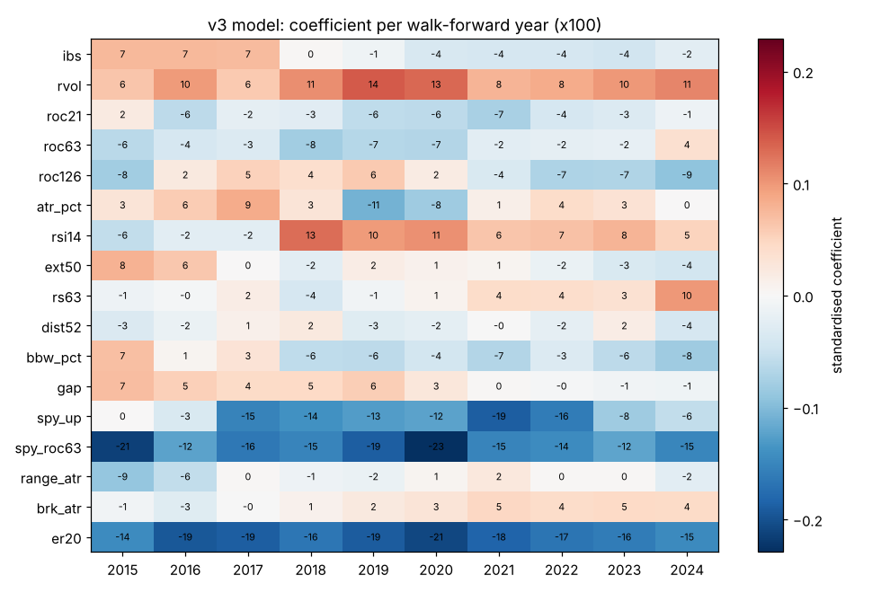
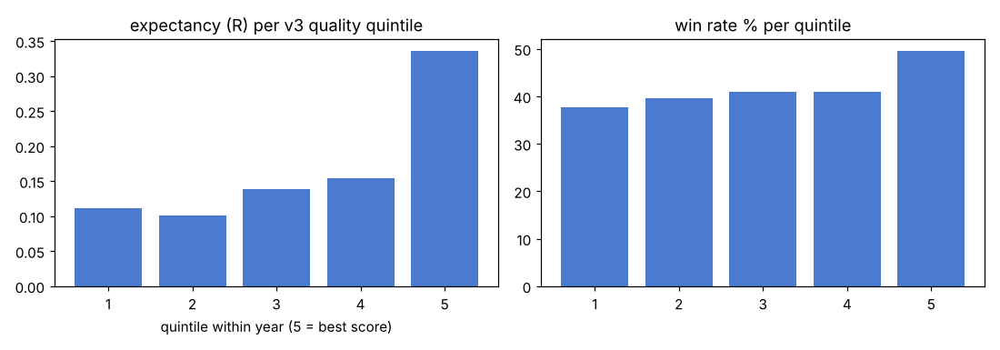
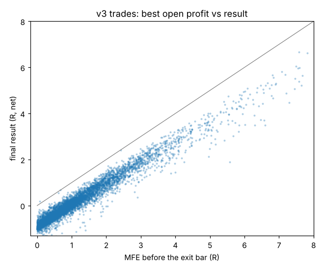
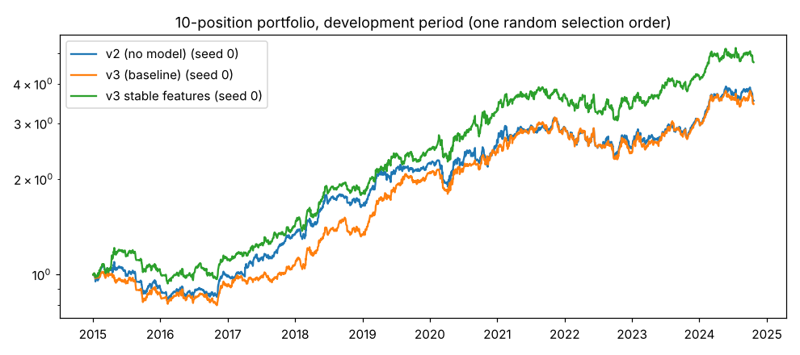

# Swing v4 — phase 1: diagnosis of v3 (development data only)

Development data: 253 tickers (every ticker used in earlier sessions), entries 2015-01-01 .. 2024-10-21; every series is cut before the holdout start (2024-10-22) and the 84 holdout tickers are refused by the data loader. Costs 0.1% per side. R = 4 x ATR(signal bar) = the initial stop distance. Portfolio: max 10 positions of 10% each, same-day signals in random order, averaged over 20 orders. Model trained on DEV (15 tickers) and refit every year on trades closed before 1 January.

## Baselines

| system | trades | win | exp % [95% CI] | exp R [95% CI] | PF | avg win / avg loss | CAGR (range over 20 orders) | max DD | MAR (range) | hold (bars) | exposure |
|---|---|---|---|---|---|---|---|---|---|---|---|
| v2 (no model) | 6754 | 43.5% | 2.31% [1.94, 2.71] | 0.197 [0.167, 0.226] | 1.71 | 12.7% / -5.7% (1.16R / -0.55R) | 13.7% (11.9–18.0) | -28.7% | 0.49 (0.36–0.74) | 32 | 93% |
| v3 (baseline) | 6146 | 44.1% | 2.28% [1.90, 2.67] | 0.200 [0.171, 0.231] | 1.73 | 12.2% / -5.6% (1.15R / -0.55R) | 14.7% (11.3–18.4) | -25.1% | 0.60 (0.44–0.81) | 33 | 92% |
| v3 stable features | 6376 | 43.9% | 2.41% [2.01, 2.82] | 0.200 [0.170, 0.231] | 1.75 | 12.8% / -5.7% (1.16R / -0.55R) | 17.3% (13.5–19.4) | -24.9% | 0.70 (0.55–0.89) | 32 | 93% |

Portfolio crowding (v3): 693 of 6146 trades taken (11%), 1365 of 1643 signal days had more signals than free slots.

v3 per year (trade level):

| year | trades | win % | exp R |
|---|---|---|---|
| 2015 | 585 | 33.3 | -0.123 |
| 2016 | 638 | 48.6 | 0.252 |
| 2017 | 669 | 56.1 | 0.617 |
| 2018 | 606 | 34.0 | -0.024 |
| 2019 | 645 | 54.3 | 0.383 |
| 2020 | 426 | 51.6 | 0.429 |
| 2021 | 835 | 42.8 | 0.159 |
| 2022 | 492 | 32.1 | -0.126 |
| 2023 | 767 | 46.9 | 0.338 |
| 2024 | 483 | 36.9 | -0.031 |

## 1. Feature stability (standardised coefficient x100 per walk-forward fit)

| feature | 2015 | 2016 | 2017 | 2018 | 2019 | 2020 | 2021 | 2022 | 2023 | 2024 | + years | − years |
|---|---|---|---|---|---|---|---|---|---|---|---|---|
| er20 | -14.4 | -19.4 | -18.8 | -16.5 | -19.0 | -20.9 | -18.3 | -16.8 | -16.0 | -14.7 | 0 | 10 |
| spy_roc63 | -21.4 | -12.2 | -16.4 | -15.0 | -18.9 | -22.9 | -15.2 | -14.3 | -12.0 | -14.9 | 0 | 10 |
| spy_up | 0.0 | -3.4 | -15.2 | -13.9 | -12.7 | -12.2 | -18.9 | -16.0 | -8.1 | -5.6 | 0 | 9 |
| rvol | 6.3 | 9.8 | 6.1 | 10.6 | 14.0 | 13.2 | 7.8 | 8.4 | 9.9 | 11.2 | 10 | 0 |
| rsi14 | -5.6 | -2.5 | -2.3 | 12.8 | 9.7 | 10.5 | 6.4 | 6.6 | 7.7 | 5.2 | 7 | 3 |
| roc126 | -8.0 | 2.3 | 5.3 | 3.9 | 6.0 | 1.9 | -3.6 | -7.1 | -6.9 | -9.2 | 5 | 5 |
| bbw_pct | 7.0 | 0.6 | 3.1 | -5.9 | -6.1 | -4.1 | -6.6 | -3.1 | -6.0 | -8.1 | 3 | 7 |
| atr_pct | 2.9 | 5.9 | 8.5 | 2.9 | -10.8 | -8.1 | 1.4 | 4.3 | 3.4 | 0.2 | 8 | 2 |
| roc63 | -6.2 | -3.9 | -3.1 | -8.0 | -6.5 | -6.7 | -2.4 | -2.0 | -1.8 | 3.7 | 1 | 9 |
| ibs | 7.5 | 7.3 | 7.2 | 0.3 | -0.9 | -3.6 | -3.8 | -3.8 | -4.3 | -2.4 | 4 | 6 |
| roc21 | 2.0 | -6.0 | -2.0 | -2.7 | -5.8 | -6.0 | -7.5 | -3.9 | -3.2 | -1.2 | 1 | 9 |
| gap | 7.0 | 5.5 | 4.4 | 4.6 | 5.6 | 2.6 | 0.2 | -0.3 | -0.9 | -0.9 | 7 | 3 |
| rs63 | -1.1 | -0.5 | 1.8 | -3.8 | -0.8 | 0.8 | 4.3 | 4.0 | 3.4 | 10.0 | 6 | 4 |
| ext50 | 7.9 | 6.1 | 0.0 | -2.4 | 1.8 | 1.0 | 0.7 | -1.6 | -3.4 | -4.3 | 6 | 4 |
| brk_atr | -0.8 | -2.8 | -0.2 | 1.0 | 2.3 | 3.0 | 4.7 | 4.2 | 4.6 | 4.3 | 7 | 3 |
| range_atr | -8.9 | -5.6 | 0.2 | -1.1 | -1.6 | 0.7 | 2.4 | 0.3 | 0.3 | -2.4 | 5 | 5 |
| dist52 | -3.3 | -1.6 | 1.2 | 2.3 | -2.8 | -2.2 | -0.1 | -2.0 | 1.6 | -3.9 | 3 | 7 |

## 2. What the model adds out of sample

AUC (win/loss of each candidate traded on its own) per year:

| year | candidates | win % | AUC v3 (17 features) | AUC 3 stable features |
|---|---|---|---|---|
| 2015 | 2050 | 29.5 | 0.537 | 0.573 |
| 2016 | 2874 | 42.6 | 0.609 | 0.619 |
| 2017 | 3679 | 53.1 | 0.491 | 0.497 |
| 2018 | 2830 | 31.9 | 0.555 | 0.572 |
| 2019 | 3523 | 48.3 | 0.566 | 0.567 |
| 2020 | 3423 | 45.7 | 0.549 | 0.593 |
| 2021 | 4021 | 40.3 | 0.530 | 0.512 |
| 2022 | 1564 | 27.2 | 0.655 | 0.630 |
| 2023 | 3530 | 44.9 | 0.534 | 0.556 |
| 2024 | 2212 | 36.8 | 0.494 | 0.471 |
| mean | | | 0.552 | 0.559 |

Quality quintiles (ranked within each year; each candidate traded on its own):

| quintile | v3: n | win % | exp % | exp R | stable: win % | exp % | exp R |
|---|---|---|---|---|---|---|---|
| Q1 | 5944 | 37.7 | 1.01 | 0.112 | 37.0 | 0.38 | 0.072 |
| Q2 | 5940 | 39.5 | 0.78 | 0.101 | 39.3 | 0.59 | 0.087 |
| Q3 | 5939 | 40.9 | 1.17 | 0.139 | 40.3 | 1.03 | 0.131 |
| Q4 | 5940 | 41.0 | 1.44 | 0.155 | 41.9 | 1.68 | 0.177 |
| Q5 | 5943 | 49.5 | 4.20 | 0.335 | 50.2 | 4.91 | 0.376 |

Q5 − Q1 (exp R) per year, v3: 2015: +0.11, 2016: +0.40, 2017: -0.15, 2018: +0.36, 2019: +0.39, 2020: +0.53, 2021: +0.14, 2022: +0.33, 2023: +0.26, 2024: -0.17

## 3. Trade anatomy (v3, MFE/MAE in R; path = bars before the exit bar)

| touched before exit | share of trades | of those: end as loss | end within ±0.25R | end below +0.5R | mean final R |
|---|---|---|---|---|---|
| +0.5R | 64.2% (3943) | 31.4% | 29.6% | 56.6% | 0.70 |
| +1.0R | 41.5% (2548) | 5.4% | 16.8% | 33.0% | 1.19 |
| +1.5R | 27.2% (1674) | 0.7% | 1.7% | 7.4% | 1.68 |
| +2.0R | 17.9% (1101) | 0.1% | 0.3% | 0.5% | 2.17 |
| +3.0R | 8.0% (493) | 0.0% | 0.0% | 0.0% | 3.17 |

- Never touched +0.5R: 35.8% of trades, mean result -0.70R.
- Winners: mean MFE 2.18R, mean exit 1.17R → give back 1.01R = 56% of their best open profit (median 53%).
- Top 10% trades (615): **151% of the total net P&L** (135% of total R); mean 2.71R, hold 76 bars, MFE 3.98R. The other 90%: -0.079R per trade, win 37.9%. Top 5%: 107%, top 1%: 43% of P&L.
- Median bars to +1R (if reached): 18; 60% of trades had not touched +0.5R within 10 bars. Exit reasons: {'stop': 5385, 'signal': 761}.

## 4. Winners vs losers at the BUY (v3 trades; d = standardised mean difference)

| feature | winners | losers | d | AUC | Spearman with R |
|---|---|---|---|---|---|
| spy_roc63 | 0.029 | 0.042 | -0.230 | 0.440 | -0.109 |
| spy_up | 0.825 | 0.888 | -0.181 | 0.469 | -0.092 |
| breadth200 | 0.691 | 0.720 | -0.161 | 0.467 | -0.059 |
| winter | 0.543 | 0.471 | +0.144 | 0.536 | +0.083 |
| spy_vol20 | 0.155 | 0.143 | +0.128 | 0.512 | +0.029 |
| vix | 16.977 | 16.451 | +0.095 | 0.509 | +0.028 |
| vol_ratio | 1.022 | 0.996 | +0.092 | 0.527 | +0.042 |
| prob | 0.500 | 0.490 | +0.090 | 0.518 | +0.021 |
| ext200 | 4.483 | 4.710 | -0.069 | 0.480 | -0.042 |
| breadth50 | 0.658 | 0.670 | -0.065 | 0.484 | -0.019 |
| log_dollar_vol | 8.402 | 8.438 | -0.057 | 0.479 | -0.037 |
| roc63 | 0.099 | 0.112 | -0.054 | 0.474 | -0.044 |
| rvol | 0.206 | 0.180 | +0.053 | 0.513 | +0.019 |
| ext50 | 2.408 | 2.475 | -0.048 | 0.486 | -0.019 |
| ibs | 0.878 | 0.882 | -0.048 | 0.484 | -0.026 |
| bbw_pct | 0.478 | 0.466 | +0.046 | 0.514 | +0.039 |

## 5. Portfolio

- v2 (no model): CAGR 13.7% (range 11.9–18.0% over 20 random orders), MAR 0.49 (0.36–0.74); 717 of 6754 signals taken, 1443/1709 signal days crowded.
- v3 (baseline): CAGR 14.7% (range 11.3–18.4% over 20 random orders), MAR 0.60 (0.44–0.81); 693 of 6146 signals taken, 1365/1643 signal days crowded.
- v3 stable features: CAGR 17.3% (range 13.5–19.4% over 20 random orders), MAR 0.70 (0.55–0.89); 701 of 6376 signals taken, 1404/1682 signal days crowded.

## Survivorship

- Tickers in the development universe whose data stops before the cutoff (delisted): 0. yfinance has no delisted symbols, so every universe here consists of survivors.
| group | trades | win % | exp R |
|---|---|---|---|
| DEV (mega caps, hindsight) | 438 | 50.5 | 0.326 |
| old HOLDOUT (large caps) | 427 | 45.0 | 0.273 |
| TRAIN_EXTRA (large caps) | 1347 | 44.0 | 0.118 |
| VOLATILE (incl. later collapses) | 1186 | 39.5 | 0.178 |
| LOCKBOX (2015-25 winners, hindsight) | 1267 | 45.1 | 0.267 |
| LOCKBOX2 (quality compounders) | 1481 | 44.7 | 0.178 |

Experiments logged so far: 3.
