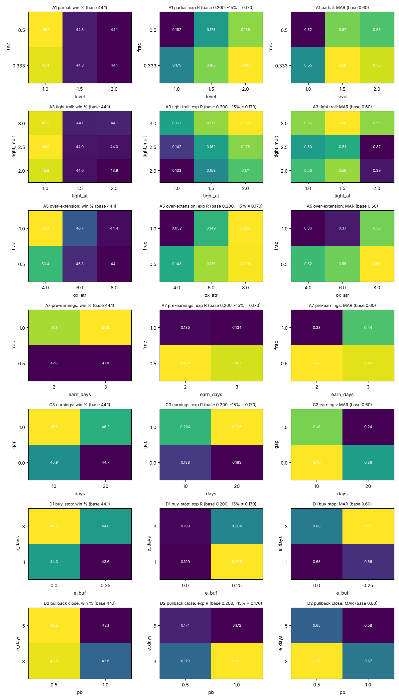
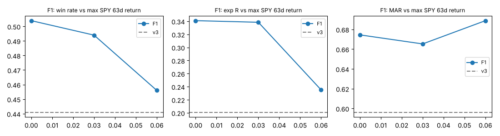

# Swing v4 — phase 2: improvements tested one by one (development data only)

Trials logged in `experiments.csv`: **104** (3 phase-1 baselines + 101 phase-2 trials). Each idea is compared with baseline v3 (win 44.1%, 2.28% / 0.200R per trade, MAR 0.60). Flags in order: win↑, exp%, expR, MAR, ≥70% yrs, half A, half B, ≤2 par. Trade-level ideas are judged on all trades of the 253-ticker universe; ranking / sizing ideas on the trades the 10-position portfolio really takes. MAR = mean of 20 random selection orders (its own spread between orders is about ±0.15).

## A. Taking profit earlier

| idea | trades | win | exp % | exp R | PF | avg win / loss | CAGR | max DD | MAR | hold | expo | years | top-10% R | flags |
|---|---|---|---|---|---|---|---|---|---|---|---|---|---|---|
| A1 partial 0.33 at +1.0R | 6146 | 46.1% | 1.97% | 0.175 | 1.64 | 10.9% / -5.7% | 12.8% | -23.6% | 0.55 | 33 | 92% | 0.5 | 2.15 | <Flags(allows_duplicate_labels=True)> |
| A1 partial 0.50 at +1.0R | 6146 | 46.2% | 1.81% | 0.162 | 1.59 | 10.6% / -5.7% | 11.8% | -22.9% | 0.52 | 33 | 92% | 0.5 | 1.88 | <Flags(allows_duplicate_labels=True)> |
| A1 partial 0.33 at +1.5R | 6146 | 44.3% | 2.09% | 0.185 | 1.67 | 11.7% / -5.6% | 13.6% | -23.9% | 0.58 | 33 | 92% | 0.3 | 2.32 | <Flags(allows_duplicate_labels=True)> |
| A1 partial 0.50 at +1.5R | 6146 | 44.3% | 1.99% | 0.178 | 1.64 | 11.5% / -5.6% | 13.0% | -23.3% | 0.57 | 33 | 92% | 0.3 | 2.12 | <Flags(allows_duplicate_labels=True)> |
| A1 partial 0.33 at +2.0R | 6146 | 44.1% | 2.15% | 0.191 | 1.69 | 11.9% / -5.6% | 13.8% | -24.3% | 0.58 | 33 | 92% | 0.1 | 2.46 | <Flags(allows_duplicate_labels=True)> |
| A1 partial 0.50 at +2.0R | 6146 | 44.1% | 2.09% | 0.186 | 1.67 | 11.8% / -5.6% | 13.3% | -23.9% | 0.56 | 33 | 92% | 0.1 | 2.34 | <Flags(allows_duplicate_labels=True)> |
| A2 break-even stop at +1.0R | 6152 | 43.9% | 2.28% | 0.200 | 1.74 | 12.2% / -5.5% | 15.7% | -25.3% | 0.63 | 32 | 92% | 0.1 | 2.71 | <Flags(allows_duplicate_labels=True)> |
| A2 break-even stop at +1.5R | 6146 | 44.1% | 2.28% | 0.200 | 1.73 | 12.2% / -5.6% | 14.7% | -25.1% | 0.60 | 33 | 92% | 0.0 | 2.71 | <Flags(allows_duplicate_labels=True)> |
| A3 tight trail 2.0xATR after +1.0R | 7163 | 45.9% | 1.40% | 0.133 | 1.46 | 9.7% / -5.6% | 14.7% | -28.2% | 0.53 | 23 | 92% | 0.4 | 1.44 | <Flags(allows_duplicate_labels=True)> |
| A3 tight trail 2.5xATR after +1.0R | 6931 | 46.0% | 1.48% | 0.142 | 1.49 | 9.8% / -5.6% | 13.4% | -27.3% | 0.50 | 25 | 92% | 0.4 | 1.60 | <Flags(allows_duplicate_labels=True)> |
| A3 tight trail 3.0xATR after +1.0R | 6652 | 45.9% | 1.81% | 0.163 | 1.59 | 10.6% / -5.7% | 14.1% | -25.6% | 0.56 | 27 | 92% | 0.4 | 1.98 | <Flags(allows_duplicate_labels=True)> |
| A3 10-day-low trail after +1.0R | 6753 | 45.3% | 1.76% | 0.161 | 1.58 | 10.6% / -5.6% | 12.8% | -28.4% | 0.45 | 27 | 92% | 0.4 | 1.88 | <Flags(allows_duplicate_labels=True)> |
| A3 tight trail 2.0xATR after +1.5R | 6726 | 44.0% | 1.67% | 0.158 | 1.54 | 10.8% / -5.5% | 14.0% | -25.4% | 0.56 | 26 | 92% | 0.2 | 1.82 | <Flags(allows_duplicate_labels=True)> |
| A3 tight trail 2.5xATR after +1.5R | 6606 | 44.0% | 1.74% | 0.162 | 1.56 | 11.0% / -5.5% | 13.0% | -25.7% | 0.51 | 28 | 92% | 0.3 | 1.97 | <Flags(allows_duplicate_labels=True)> |
| A3 tight trail 3.0xATR after +1.5R | 6448 | 44.1% | 1.99% | 0.177 | 1.64 | 11.5% / -5.5% | 14.8% | -25.2% | 0.60 | 29 | 92% | 0.5 | 2.23 | <Flags(allows_duplicate_labels=True)> |
| A3 10-day-low trail after +1.5R | 6503 | 44.2% | 1.96% | 0.175 | 1.64 | 11.4% / -5.5% | 14.2% | -26.3% | 0.55 | 29 | 92% | 0.4 | 2.18 | <Flags(allows_duplicate_labels=True)> |
| A3 tight trail 2.0xATR after +2.0R | 6506 | 43.9% | 1.90% | 0.171 | 1.61 | 11.4% / -5.5% | 11.8% | -31.0% | 0.39 | 29 | 92% | 0.2 | 2.14 | <Flags(allows_duplicate_labels=True)> |
| A3 tight trail 2.5xATR after +2.0R | 6429 | 44.0% | 1.95% | 0.176 | 1.63 | 11.5% / -5.5% | 10.8% | -29.3% | 0.37 | 29 | 92% | 0.3 | 2.25 | <Flags(allows_duplicate_labels=True)> |
| A3 tight trail 3.0xATR after +2.0R | 6336 | 44.1% | 2.10% | 0.185 | 1.68 | 11.8% / -5.5% | 14.3% | -26.0% | 0.56 | 30 | 92% | 0.4 | 2.41 | <Flags(allows_duplicate_labels=True)> |
| A3 10-day-low trail after +2.0R | 6360 | 44.2% | 2.07% | 0.184 | 1.67 | 11.7% / -5.5% | 13.2% | -27.1% | 0.49 | 30 | 92% | 0.3 | 2.37 | <Flags(allows_duplicate_labels=True)> |
| A4 time stop 5 bars (<+0.5R) | 9725 | 47.4% | 0.75% | 0.068 | 1.45 | 5.1% / -3.2% | 14.2% | -22.8% | 0.63 | 12 | 92% | 0.4 | 1.09 | <Flags(allows_duplicate_labels=True)> |
| A4 time stop 10 bars (<+0.5R) | 7905 | 46.5% | 1.33% | 0.121 | 1.58 | 7.8% / -4.3% | 14.7% | -22.2% | 0.67 | 20 | 93% | 0.4 | 1.79 | <Flags(allows_duplicate_labels=True)> |
| A4 time stop 15 bars (<+0.5R) | 7116 | 45.6% | 1.65% | 0.150 | 1.62 | 9.5% / -4.9% | 15.9% | -21.7% | 0.74 | 25 | 93% | 0.5 | 2.18 | <Flags(allows_duplicate_labels=True)> |
| A5 over-extension 0.5 out at SMA50+4.0ATR | 6146 | 50.4% | 1.59% | 0.143 | 1.60 | 8.5% / -5.4% | 10.9% | -21.3% | 0.52 | 33 | 92% | 0.5 | 1.74 | <Flags(allows_duplicate_labels=True)> |
| A5 over-extension 1.0 out at SMA50+4.0ATR | 10237 | 53.4% | 0.58% | 0.052 | 1.31 | 4.6% / -4.0% | 11.6% | -33.4% | 0.36 | 10 | 91% | 0.4 | 0.77 | <Flags(allows_duplicate_labels=True)> |
| A5 over-extension 0.5 out at SMA50+6.0ATR | 6146 | 45.3% | 2.04% | 0.179 | 1.67 | 11.2% / -5.6% | 13.2% | -24.6% | 0.55 | 33 | 92% | 0.6 | 2.30 | <Flags(allows_duplicate_labels=True)> |
| A5 over-extension 1.0 out at SMA50+6.0ATR | 7103 | 46.7% | 1.67% | 0.149 | 1.59 | 9.6% / -5.3% | 11.2% | -30.8% | 0.37 | 24 | 93% | 0.4 | 1.89 | <Flags(allows_duplicate_labels=True)> |
| A5 over-extension 0.5 out at SMA50+8.0ATR | 6146 | 44.1% | 2.28% | 0.199 | 1.73 | 12.2% / -5.6% | 14.6% | -24.8% | 0.60 | 33 | 92% | 0.2 | 2.66 | <Flags(allows_duplicate_labels=True)> |
| A5 over-extension 1.0 out at SMA50+8.0ATR | 6263 | 44.4% | 2.29% | 0.200 | 1.74 | 12.1% / -5.5% | 14.2% | -26.4% | 0.55 | 31 | 92% | 0.8 | 2.61 | <Flags(allows_duplicate_labels=True)> |
| A5 RSI>80 0.5 out | 6146 | 44.8% | 2.10% | 0.184 | 1.68 | 11.5% / -5.6% | 13.7% | -24.3% | 0.57 | 33 | 92% | 0.8 | 2.39 | <Flags(allows_duplicate_labels=True)> |
| A5 RSI>80 1.0 out | 6708 | 45.5% | 1.86% | 0.164 | 1.62 | 10.7% / -5.5% | 13.1% | -27.4% | 0.49 | 27 | 92% | 0.4 | 2.08 | <Flags(allows_duplicate_labels=True)> |
| A6 fixed target +2.0R (whole position) | 6709 | 43.7% | 1.85% | 0.167 | 1.60 | 11.3% / -5.5% | 14.4% | -24.9% | 0.58 | 27 | 92% | 0.2 | 1.97 | <Flags(allows_duplicate_labels=True)> |
| A6 fixed target +3.0R (whole position) | 6383 | 43.9% | 2.13% | 0.192 | 1.68 | 11.9% / -5.5% | 14.4% | -24.9% | 0.58 | 30 | 92% | 0.2 | 2.47 | <Flags(allows_duplicate_labels=True)> |
| A7 pre-earnings 0.5 out (2d) | 6146 | 47.8% | 1.86% | 0.169 | 1.66 | 9.8% / -5.4% | 11.0% | -23.8% | 0.47 | 33 | 92% | 0.6 | 2.05 | <Flags(allows_duplicate_labels=True)> |
| A7 pre-earnings 1.0 out (2d) | 7292 | 51.3% | 1.42% | 0.135 | 1.52 | 8.1% / -5.6% | 10.9% | -29.2% | 0.38 | 24 | 93% | 0.4 | 1.40 | <Flags(allows_duplicate_labels=True)> |
| A7 pre-earnings 0.5 out (3d) | 6146 | 47.8% | 1.83% | 0.167 | 1.65 | 9.7% / -5.4% | 10.8% | -23.6% | 0.47 | 33 | 92% | 0.5 | 2.03 | <Flags(allows_duplicate_labels=True)> |
| A7 pre-earnings 1.0 out (3d) | 7369 | 51.8% | 1.40% | 0.134 | 1.52 | 7.9% / -5.6% | 11.4% | -26.0% | 0.44 | 24 | 93% | 0.4 | 1.36 | <Flags(allows_duplicate_labels=True)> |

## B. Selection / ranking

| idea | trades | win | exp % | exp R | PF | avg win / loss | CAGR | max DD | MAR | hold | expo | years | top-10% R | flags |
|---|---|---|---|---|---|---|---|---|---|---|---|---|---|---|
| B1 rank by mom126_xs | 6146 | 41.9% | 1.62% | 0.142 | 1.73 | 12.2% / -5.6% | 10.0% | -26.9% | 0.37 | 33 | 92% | 0.2 | 2.71 | <Flags(allows_duplicate_labels=True)> |
| B1 rank by mom252_xs | 6146 | 43.7% | 2.58% | 0.197 | 1.73 | 12.2% / -5.6% | 15.0% | -28.2% | 0.53 | 33 | 92% | 0.3 | 2.71 | <Flags(allows_duplicate_labels=True)> |
| B1 rank by mom_12_1_xs | 6146 | 43.5% | 2.46% | 0.187 | 1.73 | 12.2% / -5.6% | 14.2% | -28.4% | 0.50 | 33 | 92% | 0.4 | 2.71 | <Flags(allows_duplicate_labels=True)> |
| B2 rank by v3 model score | 6146 | 43.6% | 2.32% | 0.190 | 1.73 | 12.2% / -5.6% | 14.8% | -27.4% | 0.54 | 33 | 92% | 0.6 | 2.71 | <Flags(allows_duplicate_labels=True)> |
| B2 rank by stable-feature score | 6146 | 43.1% | 2.40% | 0.192 | 1.73 | 12.2% / -5.6% | 13.7% | -27.1% | 0.51 | 33 | 92% | 0.3 | 2.71 | <Flags(allows_duplicate_labels=True)> |
| B3 rank by 1y ATR% | 6146 | 44.3% | 2.70% | 0.217 | 1.73 | 12.2% / -5.6% | 16.3% | -32.3% | 0.50 | 33 | 93% | 0.6 | 2.71 | <Flags(allows_duplicate_labels=True)> |
| B3 filter 1y ATR% >= 1.5 | 5468 | 43.9% | 2.46% | 0.200 | 1.75 | 13.1% / -5.9% | 14.9% | -28.9% | 0.52 | 33 | 91% | 0.4 | 2.68 | <Flags(allows_duplicate_labels=True)> |
| B3 filter 1y ATR% >= 2.0 | 4216 | 43.5% | 2.88% | 0.214 | 1.79 | 15.0% / -6.5% | 16.7% | -30.0% | 0.56 | 32 | 90% | 0.4 | 2.60 | <Flags(allows_duplicate_labels=True)> |
| B3 filter 1y ATR% >= 2.5 | 2941 | 44.1% | 3.50% | 0.234 | 1.86 | 17.1% / -7.3% | 14.5% | -27.8% | 0.52 | 32 | 85% | 0.4 | 2.53 | <Flags(allows_duplicate_labels=True)> |
| B4 sector momentum rank >= 0.5 | 4695 | 43.4% | 2.31% | 0.199 | 1.75 | 12.4% / -5.5% | 13.7% | -25.8% | 0.53 | 32 | 90% | 0.4 | 2.74 | <Flags(allows_duplicate_labels=True)> |
| B4 sector momentum rank >= 0.7 | 3589 | 43.5% | 2.31% | 0.193 | 1.77 | 12.2% / -5.3% | 11.2% | -24.4% | 0.47 | 32 | 88% | 0.3 | 2.69 | <Flags(allows_duplicate_labels=True)> |
| B4 rank by sector momentum | 6146 | 43.0% | 2.09% | 0.174 | 1.73 | 12.2% / -5.6% | 13.1% | -23.7% | 0.56 | 33 | 92% | 0.2 | 2.71 | <Flags(allows_duplicate_labels=True)> |
| B5 liquidity: 50d $vol >= 10^7.0 | 6039 | 44.0% | 2.16% | 0.195 | 1.70 | 11.9% / -5.5% | 12.8% | -26.2% | 0.49 | 33 | 92% | 0.4 | 2.70 | <Flags(allows_duplicate_labels=True)> |
| B5 liquidity: 50d $vol >= 10^7.5 | 5795 | 43.9% | 2.09% | 0.188 | 1.68 | 11.7% / -5.5% | 11.2% | -26.0% | 0.44 | 33 | 92% | 0.4 | 2.67 | <Flags(allows_duplicate_labels=True)> |
| B5 liquidity: 50d $vol >= 10^8.0 | 4973 | 43.4% | 1.86% | 0.170 | 1.60 | 11.5% / -5.5% | 8.6% | -29.1% | 0.31 | 32 | 91% | 0.2 | 2.64 | <Flags(allows_duplicate_labels=True)> |

## C. Setup quality

| idea | trades | win | exp % | exp R | PF | avg win / loss | CAGR | max DD | MAR | hold | expo | years | top-10% R | flags |
|---|---|---|---|---|---|---|---|---|---|---|---|---|---|---|
| C1 contraction ATR10/ATR50 <= 0.8 | 353 | 41.1% | 1.43% | 0.179 | 1.61 | 9.1% / -4.0% | 2.2% | -10.7% | 0.21 | 29 | 25% | 0.3 | 4.02 | <Flags(allows_duplicate_labels=True)> |
| C1 contraction ATR10/ATR50 <= 0.9 | 1798 | 41.9% | 1.62% | 0.186 | 1.62 | 10.1% / -4.5% | 10.8% | -19.2% | 0.57 | 31 | 64% | 0.3 | 3.38 | <Flags(allows_duplicate_labels=True)> |
| C1 contraction ATR10/ATR50 <= 1.0 | 3697 | 43.2% | 2.07% | 0.213 | 1.75 | 11.1% / -4.8% | 14.1% | -27.1% | 0.53 | 32 | 80% | 0.4 | 3.09 | <Flags(allows_duplicate_labels=True)> |
| C1 BB-width pct <= 0.3 at breakout | 2854 | 41.1% | 1.46% | 0.167 | 1.47 | 11.1% / -5.2% | 12.9% | -26.8% | 0.48 | 30 | 80% | 0.2 | 2.99 | <Flags(allows_duplicate_labels=True)> |
| C1 BB-width pct <= 0.5 at breakout | 4236 | 42.6% | 1.71% | 0.186 | 1.56 | 11.2% / -5.4% | 17.0% | -32.3% | 0.53 | 31 | 87% | 0.3 | 2.91 | <Flags(allows_duplicate_labels=True)> |
| C2 new 52-week high | 3021 | 42.8% | 1.71% | 0.174 | 1.60 | 10.6% / -5.0% | 12.5% | -19.4% | 0.65 | 32 | 87% | 0.3 | 2.91 | <Flags(allows_duplicate_labels=True)> |
| C2 new 126-day high | 3550 | 42.7% | 1.80% | 0.174 | 1.62 | 11.0% / -5.1% | 13.5% | -17.6% | 0.77 | 32 | 89% | 0.2 | 2.87 | <Flags(allows_duplicate_labels=True)> |
| C3 earnings <= 10d ago with gap > 0.0 ATR | 1560 | 45.9% | 2.37% | 0.188 | 1.77 | 11.9% / -5.7% | 10.9% | -23.9% | 0.46 | 35 | 77% | 0.5 | 2.37 | <Flags(allows_duplicate_labels=True)> |
| C3 earnings <= 10d ago with gap > 1.0 ATR | 933 | 47.1% | 2.68% | 0.204 | 1.84 | 12.5% / -6.1% | 10.9% | -26.3% | 0.41 | 35 | 69% | 0.4 | 2.22 | <Flags(allows_duplicate_labels=True)> |
| C3 earnings <= 20d ago with gap > 0.0 ATR | 2009 | 44.7% | 2.24% | 0.183 | 1.70 | 12.1% / -5.8% | 9.1% | -25.3% | 0.36 | 35 | 81% | 0.5 | 2.57 | <Flags(allows_duplicate_labels=True)> |
| C3 earnings <= 20d ago with gap > 1.0 ATR | 1136 | 46.2% | 2.76% | 0.216 | 1.85 | 13.0% / -6.0% | 8.0% | -33.4% | 0.24 | 36 | 72% | 0.5 | 2.51 | <Flags(allows_duplicate_labels=True)> |
| C3 gap >1.5ATR on 2x volume in last 10d | 778 | 47.2% | 3.12% | 0.224 | 1.92 | 13.8% / -6.4% | 12.0% | -24.7% | 0.48 | 35 | 67% | 0.4 | 2.15 | <Flags(allows_duplicate_labels=True)> |

## D. Entry timing

| idea | trades | win | exp % | exp R | PF | avg win / loss | CAGR | max DD | MAR | hold | expo | years | top-10% R | flags |
|---|---|---|---|---|---|---|---|---|---|---|---|---|---|---|
| D1 buy-stop signal high+0.0ATR, 1d | 5462 | 44.0% | 2.23% | 0.199 | 1.72 | 12.1% / -5.5% | 16.0% | -24.7% | 0.65 | 33 | 91% | 0.5 | 2.74 | <Flags(allows_duplicate_labels=True)> |
| D1 buy-stop signal high+0.0ATR, 3d | 5681 | 44.3% | 2.24% | 0.199 | 1.72 | 12.0% / -5.6% | 16.6% | -24.8% | 0.68 | 33 | 92% | 0.6 | 2.67 | <Flags(allows_duplicate_labels=True)> |
| D1 buy-stop signal high+0.25ATR, 1d | 4651 | 43.6% | 2.30% | 0.209 | 1.75 | 12.3% / -5.4% | 16.9% | -25.9% | 0.66 | 33 | 90% | 0.4 | 2.66 | <Flags(allows_duplicate_labels=True)> |
| D1 buy-stop signal high+0.25ATR, 3d | 5222 | 44.0% | 2.26% | 0.204 | 1.74 | 12.1% / -5.5% | 17.1% | -24.3% | 0.71 | 33 | 90% | 0.4 | 2.62 | <Flags(allows_duplicate_labels=True)> |
| D2 pullback to breakout level, 3d | 4763 | 43.1% | 2.10% | 0.184 | 1.67 | 12.1% / -5.5% | 11.8% | -23.8% | 0.51 | 32 | 92% | 0.4 | 2.72 | <Flags(allows_duplicate_labels=True)> |
| D2 pullback close-0.5ATR, 3d | 4782 | 43.5% | 2.03% | 0.179 | 1.64 | 11.9% / -5.6% | 16.1% | -20.4% | 0.81 | 32 | 92% | 0.5 | 2.61 | <Flags(allows_duplicate_labels=True)> |
| D2 pullback close-1.0ATR, 3d | 3306 | 42.6% | 2.13% | 0.192 | 1.68 | 12.3% / -5.4% | 16.6% | -25.3% | 0.67 | 31 | 91% | 0.5 | 2.77 | <Flags(allows_duplicate_labels=True)> |
| D2 pullback to breakout level, 5d | 4925 | 43.1% | 2.16% | 0.181 | 1.69 | 12.3% / -5.5% | 10.4% | -27.1% | 0.39 | 32 | 92% | 0.5 | 2.82 | <Flags(allows_duplicate_labels=True)> |
| D2 pullback close-0.5ATR, 5d | 4986 | 43.5% | 2.06% | 0.174 | 1.65 | 12.0% / -5.6% | 14.7% | -22.9% | 0.65 | 32 | 92% | 0.5 | 2.70 | <Flags(allows_duplicate_labels=True)> |
| D2 pullback close-1.0ATR, 5d | 3804 | 42.1% | 1.98% | 0.172 | 1.63 | 12.2% / -5.4% | 15.3% | -26.9% | 0.58 | 30 | 91% | 0.5 | 2.84 | <Flags(allows_duplicate_labels=True)> |

## E. Model

| idea | trades | win | exp % | exp R | PF | avg win / loss | CAGR | max DD | MAR | hold | expo | years | top-10% R | flags |
|---|---|---|---|---|---|---|---|---|---|---|---|---|---|---|
| E1 relabel +1.5R-before-1R, stable feats | 5894 | 44.5% | 2.45% | 0.207 | 1.77 | 12.7% / -5.7% | 12.8% | -24.6% | 0.53 | 32 | 92% | 0.6 | 2.60 | <Flags(allows_duplicate_labels=True)> |
| E1 relabel +1.0R-before-1R, stable feats | 5762 | 44.6% | 2.60% | 0.216 | 1.83 | 12.9% / -5.7% | 12.7% | -27.9% | 0.47 | 33 | 91% | 0.5 | 2.68 | <Flags(allows_duplicate_labels=True)> |
| E1 relabel +1.5R-before-1R, 17 feats | 5320 | 43.9% | 2.12% | 0.201 | 1.69 | 11.8% / -5.5% | 16.3% | -20.6% | 0.80 | 32 | 92% | 0.5 | 2.75 | <Flags(allows_duplicate_labels=True)> |
| E1 stable feats + breadth200 + atr1y (win label) | 5876 | 43.9% | 2.08% | 0.190 | 1.67 | 11.8% / -5.5% | 13.7% | -24.6% | 0.56 | 33 | 92% | 0.3 | 2.71 | <Flags(allows_duplicate_labels=True)> |
| E2 GBM depth2 monotone (win) | 6316 | 44.1% | 2.45% | 0.204 | 1.77 | 12.8% / -5.7% | 15.5% | -24.6% | 0.63 | 33 | 93% | 0.6 | 2.70 | <Flags(allows_duplicate_labels=True)> |
| E2 GBM depth2 monotone (R1.5) | 6359 | 43.7% | 2.41% | 0.200 | 1.74 | 12.9% / -5.8% | 14.6% | -26.8% | 0.55 | 32 | 92% | 0.3 | 2.68 | <Flags(allows_duplicate_labels=True)> |
| E3 size by v3 score (0.5x-1.5x) | 6146 | 43.8% | 2.52% | 0.213 | 1.73 | 12.2% / -5.6% | 16.7% | -23.5% | 0.72 | 33 | 93% | 0.5 | 2.71 | <Flags(allows_duplicate_labels=True)> |
| E3 size by regime (spy_roc63: 1.5x<=0, 1x<=6%, 0.5x) | 6146 | 43.6% | 2.34% | 0.203 | 1.73 | 12.2% / -5.6% | 15.3% | -23.0% | 0.68 | 33 | 82% | 0.3 | 2.71 | <Flags(allows_duplicate_labels=True)> |

## F. Regime

| idea | trades | win | exp % | exp R | PF | avg win / loss | CAGR | max DD | MAR | hold | expo | years | top-10% R | flags |
|---|---|---|---|---|---|---|---|---|---|---|---|---|---|---|
| F1 SPY 63d return <= 0.0 **ACCEPTED** | 1530 | 50.4% | 5.22% | 0.341 | 2.67 | 16.5% / -6.3% | 11.3% | -16.9% | 0.67 | 38 | 40% | 0.8 | 2.47 | <Flags(allows_duplicate_labels=True)> |
| F1 SPY 63d return <= 0.03 **ACCEPTED** | 2739 | 49.4% | 4.21% | 0.338 | 2.53 | 14.1% / -5.4% | 13.4% | -20.4% | 0.67 | 37 | 61% | 0.7 | 2.65 | <Flags(allows_duplicate_labels=True)> |
| F1 SPY 63d return <= 0.06 **ACCEPTED** | 4544 | 45.6% | 2.82% | 0.235 | 1.97 | 12.6% / -5.4% | 16.0% | -23.8% | 0.69 | 34 | 82% | 0.7 | 2.71 | <Flags(allows_duplicate_labels=True)> |
| F2 breadth200 <= 0.6 | 1596 | 49.2% | 5.33% | 0.336 | 2.73 | 17.1% / -6.1% | 7.5% | -18.0% | 0.42 | 37 | 35% | 0.8 | 2.42 | <Flags(allows_duplicate_labels=True)> |
| F2 breadth200 <= 0.7 | 2531 | 46.1% | 3.56% | 0.244 | 2.14 | 14.5% / -5.8% | 11.2% | -23.7% | 0.48 | 35 | 56% | 0.8 | 2.45 | <Flags(allows_duplicate_labels=True)> |
| F2 SPY below its SMA200 | 934 | 52.8% | 6.26% | 0.343 | 3.21 | 17.2% / -6.0% | 6.6% | -17.0% | 0.39 | 40 | 28% | 0.9 | 2.30 | <Flags(allows_duplicate_labels=True)> |
| F3 no SMA200 filter on the stock (v3 model) | 7324 | 44.7% | 2.36% | 0.200 | 1.71 | 12.8% / -6.1% | 11.2% | -29.6% | 0.39 | 32 | 94% | 0.6 | 2.73 | <Flags(allows_duplicate_labels=True)> |

## Stacking on top of F1 (compared with F1; 'vs v3' in experiments.csv notes)

| idea | trades | win | exp % | exp R | PF | avg win / loss | CAGR | max DD | MAR | hold | expo | years | top-10% R | flags |
|---|---|---|---|---|---|---|---|---|---|---|---|---|---|---|
| G1 F1 + v2 (no model) | 2805 | 49.7% | 4.27% | 0.341 | 2.53 | 14.2% / -5.5% | 13.0% | -19.8% | 0.66 | 36 | 62% | 0.5 | 3.04 | <Flags(allows_duplicate_labels=True)> |
| G2 F1 + stable-feature model | 2800 | 49.6% | 4.27% | 0.341 | 2.54 | 14.2% / -5.5% | 14.7% | -19.5% | 0.76 | 37 | 62% | 0.6 | 3.05 | <Flags(allows_duplicate_labels=True)> |
| G3 F1 + time stop 15 | 2997 | 51.0% | 3.22% | 0.262 | 2.38 | 10.9% / -4.8% | 13.5% | -19.5% | 0.71 | 28 | 60% | 0.4 | 2.39 | <Flags(allows_duplicate_labels=True)> |
| G3 F1 + time stop 10 | 3247 | 50.3% | 2.46% | 0.198 | 2.14 | 9.2% / -4.3% | 8.3% | -23.1% | 0.37 | 22 | 57% | 0.4 | 1.91 | <Flags(allows_duplicate_labels=True)> |
| G4 F1 + RSI>80 half out | 2739 | 50.2% | 3.85% | 0.305 | 2.41 | 13.1% / -5.5% | 12.8% | -19.5% | 0.67 | 37 | 61% | 0.6 | 2.59 | <Flags(allows_duplicate_labels=True)> |
| G5 F1 + out at SMA50+8ATR | 2755 | 49.7% | 4.10% | 0.321 | 2.49 | 13.8% / -5.5% | 14.6% | -20.0% | 0.75 | 35 | 60% | 0.5 | 2.82 | <Flags(allows_duplicate_labels=True)> |
| G6 F1 + 3ATR trail after +1.5R | 2775 | 49.5% | 3.67% | 0.293 | 2.33 | 13.0% / -5.5% | 12.4% | -19.1% | 0.66 | 33 | 58% | 0.3 | 2.38 | <Flags(allows_duplicate_labels=True)> |
| G7 F1 + buy-stop 3d | 2519 | 49.7% | 4.21% | 0.343 | 2.54 | 13.9% / -5.4% | 11.3% | -18.9% | 0.61 | 37 | 60% | 0.3 | 3.05 | <Flags(allows_duplicate_labels=True)> |
| G8 F1 + 1/3 out at +1.5R | 2739 | 49.7% | 3.80% | 0.305 | 2.38 | 13.2% / -5.5% | 12.3% | -19.7% | 0.63 | 37 | 61% | 0.2 | 2.54 | <Flags(allows_duplicate_labels=True)> |
| G9 F1 + break-even at +1R | 2740 | 49.3% | 4.21% | 0.339 | 2.53 | 14.1% / -5.4% | 13.3% | -20.6% | 0.65 | 37 | 61% | 0.0 | 3.03 | <Flags(allows_duplicate_labels=True)> |
| G10 F1 + idle cash in SPY>SMA200 | 2739 | 47.4% | 3.47% | 0.275 | 2.53 | 14.1% / -5.4% | 16.5% | -26.1% | 0.63 | 37 | 61% | 0.0 | 3.03 | <Flags(allows_duplicate_labels=True)> |
| G11 F1 + size by v3 score | 2739 | 47.3% | 3.58% | 0.270 | 2.53 | 14.1% / -5.4% | 14.8% | -22.0% | 0.69 | 37 | 63% | 0.4 | 3.03 | <Flags(allows_duplicate_labels=True)> |

Baseline top-10% trades: mean 2.71R. 'top-10% R' = the same trades (matched on ticker and signal bar) under the variant; a lower value means the variant cuts the tail that carries the system.

Deflated Sharpe of the accepted F1 portfolio: annual Sharpe 1.01 vs 0.30 expected for the best of 101 skill-less trials with the same spread → DSR = 0.99 (probability that the Sharpe is real after the selection).

