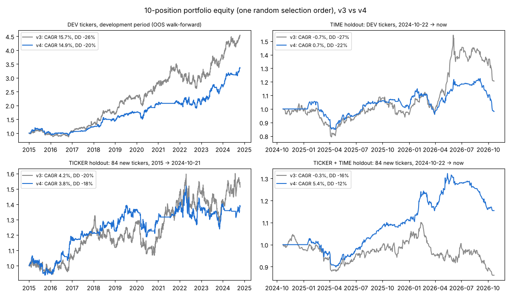
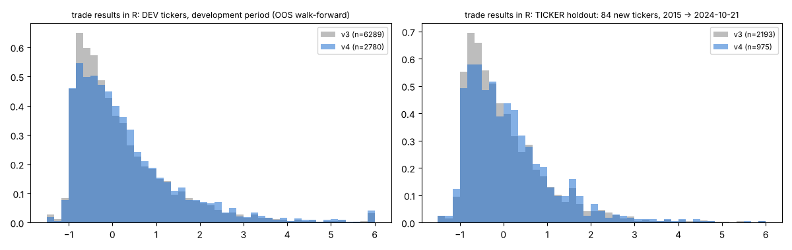

# Swing v4 — phase 3: the single holdout run

Frozen spec (`final_spec.json`, committed before this run): v3 + only take a breakout when SPY's 63-day return ≤ 0.03. Exits unchanged. Costs 0.1% per side; R = 4 x ATR(signal bar); portfolio max 10 positions (mean of 20 random selection orders). Model: v3's walk-forward yearly fits on DEV (the 2025/2026 fits now see data up to their year start, as in real use). Trades still open at the last bar are not counted.

| cell / system | trades | win | exp % | exp R [95% CI] | PF | avg win / loss | CAGR | max DD | MAR | hold | expo | top-10% share / mean R |
|---|---|---|---|---|---|---|---|---|---|---|---|---|
| **DEV tickers, development period (OOS walk-forward)** | | | | | | | | | | | | |
| v3 | 6289 | 44.8% | 2.57% | 0.224 [0.19, 0.26] | 1.84 | 12.6% / -5.5% | 15.7% | -25.7% | 0.62 | 33 | 93% | 139% / 2.80R |
| v4 | 2780 | 49.5% | 4.31% | 0.344 [0.29, 0.40] | 2.57 | 14.3% / -5.4% | 14.9% | -19.9% | 0.77 | 37 | 62% | 101% / 3.07R |
| **TIME holdout: DEV tickers, 2024-10-22 → now** | | | | | | | | | | | | |
| v3 | 1271 | 37.8% | 0.52% | 0.018 [-0.04, 0.07] | 1.12 | 13.2% / -7.2% | -0.7% | -27.4% | -0.01 | 27 | 94% | 647% / 2.24R |
| v4 | 567 | 41.1% | 1.78% | 0.069 [-0.02, 0.16] | 1.41 | 14.9% / -7.4% | 0.7% | -22.2% | 0.03 | 28 | 56% | 229% / 2.43R |
| **TICKER holdout: 84 new tickers, 2015 → 2024-10-21** | | | | | | | | | | | | |
| v3 | 2193 | 40.9% | 0.52% | 0.055 [0.01, 0.09] | 1.18 | 8.3% / -4.8% | 4.2% | -20.5% | 0.21 | 31 | 85% | 398% / 2.17R |
| v4 | 975 | 46.5% | 1.07% | 0.134 [0.07, 0.20] | 1.40 | 8.0% / -5.0% | 3.8% | -17.5% | 0.22 | 33 | 51% | 194% / 2.26R |
| **TICKER + TIME holdout: 84 new tickers, 2024-10-22 → now** | | | | | | | | | | | | |
| v3 | 449 | 38.5% | 0.93% | 0.047 [-0.06, 0.15] | 1.26 | 11.8% / -5.9% | -0.3% | -16.3% | 0.00 | 29 | 86% | 330% / 2.38R |
| v4 | 205 | 39.0% | 1.30% | 0.047 [-0.11, 0.21] | 1.37 | 12.5% / -5.8% | 5.4% | -12.1% | 0.45 | 28 | 49% | 256% / 2.49R |

## Buy & hold over the same cells (context only, nothing fitted)

| cell | equal-weight B&H of the cell's tickers: CAGR / max DD / MAR | SPY: CAGR / max DD / MAR | v3 MAR | v4 MAR |
|---|---|---|---|---|
| DEV tickers 2015-01 .. 2024-10 | 23.5% / −36.8% / 0.64 | 13.2% / −33.7% / 0.39 | 0.62 | 0.77 |
| TIME holdout (DEV tickers, 2024-10-22 → now) | 16.3% / −22.2% / 0.73 | 16.3% / −18.8% / 0.87 | −0.01 | 0.03 |
| TICKER holdout (84 new, 2015 → 2024-10) | 9.7% / −41.0% / 0.24 | 13.2% / −33.7% / 0.39 | 0.21 | 0.22 |
| TICKER + TIME holdout | 16.7% / −20.8% / 0.80 | 16.3% / −18.8% / 0.87 | 0.00 | 0.45 |

## Verdict (written after the single run; nothing was changed afterwards)

1. **v4 vs v3: the improvement holds out of sample.** In all four holdout cells v4 has a higher win rate (+0.5 to
   +5.6 pt), an equal or higher expectancy and an equal or higher MAR, i.e. it meets the three criteria of the round
   everywhere. The regime rule roughly halves the number of trades and keeps the better half.
2. **The breakout system itself is much weaker on clean data than on the development universe.** On 84 stocks
   chosen by their 2015 index membership v3 earns 0.055R per trade (development universe: 0.224R) and v4 0.134R;
   in the last two years both are close to break-even (v3 0.018R, v4 0.069R per trade). Phase 1 warned for this:
   the development universe consists of survivors and hindsight-picked winners.
3. **Neither version beats buy & hold.** On every clean cell SPY (and an equal-weight basket) had a higher CAGR and
   a higher MAR. A 10-position breakout portfolio that is ~50% in cash (v4) or that trades a weak edge (v3) can not
   keep up with an index in a strong market. The honest conclusion: v4 is a better *filter* than v3, but this
   strategy family is not a reason to replace an index position.

## What changed and why (accepted change)

- **Regime entry rule (F1): only buy a breakout when SPY's 63-day return is ≤ 3%.** Breakouts that come after a
  flat or weak market lead the next leg; after a strong 3-month market run a fresh breakout is usually late. The
  quality model had given this feature a negative weight in every walk-forward year; as an explicit rule it is
  transparent, has one parameter, and worked at 0%, 3% and 6% alike (the middle was chosen).
- Nothing else passed: earlier profit taking (partials, break-even, tighter trails, time stop, over-extension,
  fixed targets, pre-earnings exits) cut the top-10% trades that carry the P&L; rankings, setup filters, entry
  timing and new models did not beat the baseline in ≥70% of years and in both halves of the tickers.
