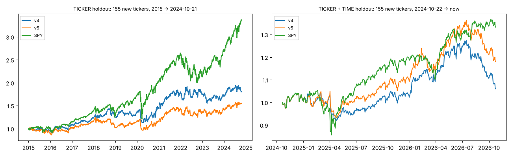

# Swing v5 — the single holdout run

Frozen spec `final_spec_v5.json` (2026-10-23): v5 = v4 + relative-strength line (close / SPY close, same date) at a new 63-day high: rs >= max(rs over the previous 63 bars) on the signal bar. System as traded: max 10 positions of 10%, idle cash in SPY while SPY > SMA200 (switch cost 0.1%) else T-bills, 0.1% per side + 0.1% entry slippage; mean of 20 random orders of same-day signals.

| cell | system | trades | win | exp R [95% CI] | CAGR | max DD | MAR | Sharpe (excess) | alpha / yr (t) | beta |
|---|---|---|---|---|---|---|---|---|---|---|
| TICKER holdout: 155 new tickers, 2015 → 2024-10-21 | v4 | 1828 | 42.3% | 0.087 [0.04, 0.13] | 5.1% | -21.8% | 0.23 | 0.30 | -2.2% (-0.7) | 0.52 |
| TICKER holdout: 155 new tickers, 2015 → 2024-10-21 | v5 | 1035 | 42.2% | 0.060 [0.00, 0.12] | 4.2% | -22.6% | 0.19 | 0.25 | -3.0% (-0.9) | 0.52 |
| TICKER holdout: 155 new tickers, 2015 → 2024-10-21 | SPY buy & hold | – | – | – | 13.2% | -33.7% | 0.39 | 0.69 | – | 1.00 |
| TICKER + TIME holdout: 155 new tickers, 2024-10-22 → now | v4 | 357 | 34.5% | -0.014 [-0.11, 0.09] | 1.4% | -16.5% | 0.08 | -0.12 | -7.3% (-0.9) | 0.47 |
| TICKER + TIME holdout: 155 new tickers, 2024-10-22 → now | v5 | 226 | 25.2% | -0.146 [-0.26, -0.02] | 4.2% | -15.8% | 0.27 | 0.08 | -4.7% (-0.6) | 0.50 |
| TICKER + TIME holdout: 155 new tickers, 2024-10-22 → now | SPY buy & hold | – | – | – | 15.5% | -18.8% | 0.83 | 0.71 | – | 1.00 |

## Conclusie (geschreven na de run; daarna is niets meer aangepast)

- **v5 houdt geen stand.** Op 155 nooit gebruikte aandelen (2015 → 2024-10) is v5 niet beter dan v4: CAGR 4,2% vs 5,1%,
  MAR 0,19 vs 0,23, verwachting 0,060R vs 0,087R. In de recente periode is de CAGR van v5 hoger (4,2% vs 1,4%), maar
  met 226 trades, een negatieve verwachting (−0,146R) en een interval dat 0 niet bevat aan de goede kant: ruis.
  De relatieve-sterkte-regel was op de ontwikkeldata beter (MAR 0,68 vs 0,59) en is dat hier niet: **bewezen** niet
  generaliserend. v5 wordt dus niet uitgebracht; v4.1 blijft de versie.
- **Belangrijker: ook v4 zelf valt sterk terug op nieuwe aandelen.** Verwachting 0,087R per trade (ontwikkeldata
  ~0,33R), CAGR 5,1% tegen 13,2% voor SPY, alpha −2,2%/jaar (t −0,7). Ook in de recente periode: 1,4% tegen 15,5%.
  De kleinere drawdown (−21,8% vs −33,7%) blijft wel staan.
- **Waarschijnlijke oorzaak (sterk vermoeden):** de ontwikkelaandelen zijn grotendeels namen die we kenden als
  volatiele groeiers (VOLATILE, LOCKBOX, …), de holdout zijn gewone S&P 500-namen van 2015. E30/E56 lieten al zien dat
  het voordeel per trade groeit met de volatiliteit van het aandeel. Op een "gewoon" universum is er nauwelijks voordeel.
- Wat dit betekent voor gebruik: de indicator is een **risicobeperker** (minder diep onderuit), geen rendementsmachine.
  Wie het rendement van de markt wil, verslaat SPY kopen en vasthouden hier niet.
