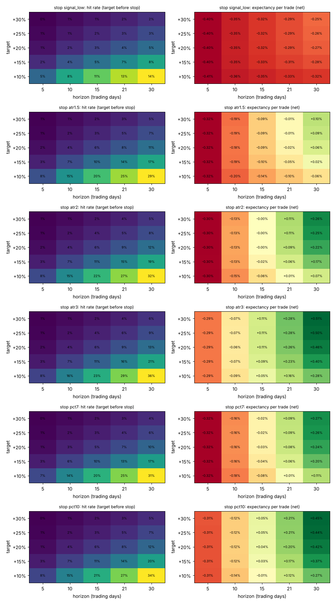

# Swing 20/21 — phase 0: base rates (development data, before any setup)

Every day of 2188 development stocks (of 3473) from 2013-01 to 2024-09 that passes the point-in-time filters (close > $5, 50-day dollar volume > $5M, a year of history) is treated as a signal: 3,152,564 stock-days. Buy at the next open, +20% limit, stop, time exit at the close of day 21 (fill day = day 1); stop wins inside a bar; costs 0.15% per side + slippage by dollar volume on market fills. Survivor-biased: only stocks listed today are in the data.

## 1. +20% within 21 days, a random stock on a random day

| stop | median stop distance | hit (target first) | 95% CI (by month) | stopped | time exit | expectancy | 95% CI | break-even hit rate | median days to target |
|---|---|---|---|---|---|---|---|---|---|
| signal_low | 1.2% | 4.1% | 3.5–4.7% | 82.7% | 13.2% | -0.29% | -0.46–-0.11% | 7.0% | 10 |
| atr1.5 | 4.2% | 7.9% | 6.8–9.0% | 58.2% | 33.9% | -0.05% | -0.46–+0.37% | 18.5% | 11 |
| atr2 | 5.5% | 8.6% | 7.4–9.8% | 47.3% | 44.1% | +0.07% | -0.42–+0.58% | 22.9% | 12 |
| atr3 | 8.3% | 9.1% | 7.8–10.4% | 30.1% | 60.8% | +0.25% | -0.34–+0.85% | 30.4% | 12 |
| pct7 | 7.0% | 7.2% | 6.3–8.2% | 40.1% | 52.6% | +0.06% | -0.38–+0.51% | 27.0% | 12 |
| pct10 | 10.0% | 8.1% | 7.1–9.2% | 26.7% | 65.1% | +0.18% | -0.35–+0.71% | 34.3% | 12 |

The break-even hit rate assumes every trade ends at the target or the stop; time exits (most trades) add their own average, which is why the expectancy is the number that counts.

### Volatility (1-year mean ATR% of the stock)

| bucket | n (sampled days) | hit pct10 | exp pct10 | hit atr2 | exp atr2 |
|---|---|---|---|---|---|
| <1.5% | 46949 | 0.4% | +0.23% | 0.4% | +0.13% |
| 1.5–2.5% | 352337 | 1.4% | +0.22% | 1.4% | +0.08% |
| 2.5–3.5% | 293133 | 5.5% | +0.26% | 5.4% | +0.11% |
| 3.5–5% | 199721 | 12.9% | +0.36% | 12.9% | +0.31% |
| 5–7% | 99682 | 22.0% | -0.01% | 23.2% | +0.09% |
| >7% | 59738 | 27.9% | -0.79% | 34.7% | -1.09% |

### Size proxy: 50-day dollar volume (no point-in-time market cap available)

| bucket | n (sampled days) | hit pct10 | exp pct10 | hit atr2 | exp atr2 |
|---|---|---|---|---|---|
| $5–10M | 176948 | 10.5% | -0.30% | 11.3% | -0.38% |
| $10–25M | 256504 | 9.1% | +0.05% | 9.6% | -0.06% |
| $25–100M | 334786 | 7.7% | +0.23% | 8.1% | +0.13% |
| $100–500M | 224405 | 6.2% | +0.57% | 6.5% | +0.43% |
| >$500M | 58936 | 6.6% | +0.43% | 7.0% | +0.24% |

### Price

| bucket | n (sampled days) | hit pct10 | exp pct10 | hit atr2 | exp atr2 |
|---|---|---|---|---|---|
| $5–10 | 77490 | 15.5% | +0.36% | 17.3% | +0.42% |
| $10–20 | 175388 | 11.0% | +0.21% | 11.7% | +0.18% |
| $20–50 | 374962 | 7.5% | +0.20% | 7.8% | +0.10% |
| $50–200 | 355157 | 5.7% | +0.20% | 5.9% | +0.03% |
| >$200 | 68582 | 8.4% | -0.32% | 9.7% | -0.62% |

### Market: SPY 63-day return

| bucket | n (sampled days) | hit pct10 | exp pct10 | hit atr2 | exp atr2 |
|---|---|---|---|---|---|
| <−5% | 104419 | 17.2% | +2.18% | 19.9% | +2.60% |
| −5–0% | 131945 | 8.0% | -0.43% | 8.3% | -0.61% |
| 0–3% | 153220 | 7.0% | +0.86% | 7.1% | +0.63% |
| 3–6% | 274356 | 6.2% | +0.11% | 6.4% | -0.09% |
| >6% | 387639 | 7.5% | -0.37% | 7.8% | -0.50% |

### Market: VIX

| bucket | n (sampled days) | hit pct10 | exp pct10 | hit atr2 | exp atr2 |
|---|---|---|---|---|---|
| <15 | 443706 | 5.1% | -0.09% | 5.1% | -0.16% |
| 15–20 | 302054 | 6.8% | -0.23% | 7.0% | -0.51% |
| 20–30 | 247644 | 11.9% | +0.60% | 12.7% | +0.39% |
| >30 | 58175 | 22.2% | +2.57% | 26.0% | +3.40% |

### Market: SPY above its SMA200

| bucket | n (sampled days) | hit pct10 | exp pct10 | hit atr2 | exp atr2 |
|---|---|---|---|---|---|
| no | 175444 | 13.7% | +0.67% | 15.6% | +0.98% |
| yes | 876135 | 7.0% | +0.08% | 7.2% | -0.12% |

### Sector proxy (sector ETF the stock correlated with most over the past year)

| bucket | n (sampled days) | hit pct10 | exp pct10 | hit atr2 | exp atr2 |
|---|---|---|---|---|---|
| XLB | 84100 | 7.9% | -0.00% | 8.1% | -0.05% |
| XLC | 27422 | 15.5% | +0.15% | 17.0% | +0.05% |
| XLE | 72692 | 12.2% | -0.16% | 13.6% | +0.05% |
| XLF | 155633 | 5.4% | +0.30% | 5.6% | +0.14% |
| XLI | 202604 | 5.8% | +0.36% | 5.9% | +0.18% |
| XLK | 131031 | 9.3% | +0.19% | 9.7% | -0.00% |
| XLP | 36070 | 3.1% | +0.24% | 3.2% | +0.14% |
| XLRE | 42711 | 6.3% | +0.07% | 6.8% | +0.02% |
| XLU | 32957 | 2.4% | +0.20% | 2.8% | +0.09% |
| XLV | 73728 | 8.4% | +0.31% | 8.8% | +0.15% |
| XLY | 192631 | 11.7% | +0.07% | 12.7% | -0.04% |

### Year

| bucket | n (sampled days) | hit pct10 | exp pct10 | hit atr2 | exp atr2 |
|---|---|---|---|---|---|
| 2013 | 60402 | 4.2% | +1.48% | 4.1% | +0.94% |
| 2014 | 67380 | 3.8% | -0.01% | 3.7% | -0.16% |
| 2015 | 71522 | 3.6% | -1.50% | 3.6% | -1.32% |
| 2016 | 73364 | 6.6% | +1.14% | 6.7% | +0.77% |
| 2017 | 79909 | 4.1% | +1.21% | 4.0% | +0.88% |
| 2018 | 86985 | 5.1% | -1.09% | 5.1% | -0.93% |
| 2019 | 89145 | 5.9% | +1.11% | 5.9% | +0.86% |
| 2020 | 95806 | 18.3% | +1.27% | 20.6% | +1.97% |
| 2021 | 115634 | 10.1% | -0.05% | 10.9% | -0.49% |
| 2022 | 114576 | 10.6% | -1.32% | 11.7% | -1.30% |
| 2023 | 113422 | 9.6% | +0.24% | 9.9% | +0.13% |
| 2024 | 83434 | 9.3% | +0.37% | 9.7% | -0.01% |

## 2. Target x horizon x stop

Best cells by expectancy (all stops):

| stop | target | horizon | hit rate | stopped | expectancy |
|---|---|---|---|---|---|
| atr3 | +30% | 30 | 5.7% | 37.7% | +0.51% |
| atr3 | +25% | 30 | 8.5% | 37.6% | +0.50% |
| atr3 | +20% | 30 | 13.2% | 37.4% | +0.46% |
| pct10 | +30% | 30 | 4.8% | 33.4% | +0.45% |
| pct10 | +25% | 30 | 7.3% | 33.2% | +0.44% |
| pct10 | +20% | 30 | 11.7% | 32.8% | +0.42% |
| atr3 | +15% | 30 | 21.4% | 36.9% | +0.40% |
| pct10 | +15% | 30 | 19.5% | 31.9% | +0.37% |
| atr3 | +30% | 21 | 3.7% | 30.2% | +0.28% |
| atr3 | +25% | 21 | 5.7% | 30.1% | +0.28% |
| atr3 | +10% | 30 | 36.1% | 35.4% | +0.28% |
| pct7 | +30% | 30 | 4.1% | 47.1% | +0.27% |

+20% / 21 days per stop (all days):

| stop | hit | stopped | expectancy |
|---|---|---|---|
| signal_low | 4.1% | 82.8% | -0.29% |
| atr1.5 | 7.9% | 58.1% | -0.02% |
| atr2 | 8.6% | 47.2% | +0.09% |
| atr3 | 9.2% | 30.0% | +0.26% |
| pct7 | 7.3% | 40.1% | +0.08% |
| pct10 | 8.2% | 26.6% | +0.20% |

## 3. Break-even hit rate (target or stop, costs 0.15%/side, no extra slippage)

| target \ stop | −5% | −7% | −10% | −15% |
|---|---|---|---|---|
| +10% | 35.3% | 42.9% | 51.5% | 61.2% |
| +15% | 26.5% | 33.2% | 41.2% | 51.0% |
| +20% | 21.2% | 27.0% | 34.3% | 43.7% |
| +25% | 17.7% | 22.8% | 29.4% | 38.3% |
| +30% | 15.1% | 19.7% | 25.8% | 34.0% |

## Survivorship

- Only stocks listed on 2026-10-23 are in the data. Of the 2188 development stocks with data, 1261 were already trading in January 2013. Around 4,000+ US common stocks were listed then (NYSE + NASDAQ + AMEX), so a large part of the 2013 universe (failures, but also take-overs) is missing.
- Direction of the bias: failed stocks (stops, never +20%) are missing → base hit rates and expectancies are too high; acquired stocks (often a +20–40% premium in one day) are missing too → part of the real +20% events is missing. Net effect unknown, but for a long-only random-day study the first effect usually dominates.

## Conclusions (phase 0)

1. **A random stock-day has no edge.** +20% within 21 days comes before the stop on only 7–9% of the days (wide stops),
   4% with the signal-bar low as stop. The break-even hit rate (target or stop only) is 23–34% for the usable stops.
   The expectancy of a random day is −0.3% to +0.3% with 95% intervals that include 0: it is the market drift, not a trade.
2. **+20% / 21 days is realistic only for volatile stocks.** Stocks with a 1-year ATR below 2.5% almost never do it
   (0.4–1.4%); 3.5–5% ATR: 13%; above 7% ATR: 28–35% — but there the expectancy turns negative (−0.8 to −1.1%):
   the same names crash just as often. A setup has to lift the hit rate well above the base rate of its OWN volatility
   bucket; that difference is the edge phase 1 must find.
3. **No target/horizon combination is clearly more robust.** In the heatmaps the expectancy depends on the horizon (longer =
   more drift) and the stop (wider = fewer stop-outs), hardly on the target: +10% … +30% give the same expectancy. Tight
   stops (signal low, 1.5 ATR) lose in every cell. +20% is a reasonable target; 30 days and a 3×ATR or −10% stop are a bit
   better than 21 days, but all differences are within the noise of random days. Keep +20% / 21 days as the reference
   and test 30 days and the 3×ATR / −10% stops as variants in phase 1.
4. **The market regime is the strongest condition so far,** the same as in swing v4: after a weak market (SPY 63-day return
   below −5%) the hit rate doubles (17–20%) and the expectancy is +2.2 to +2.6%; with VIX above 30: 22–26% and +2.6 to +3.4%;
   with SPY below its SMA200: 14–16%. These periods are few (2015–16, 2018, 2020, 2022), so this needs care (clustered,
   few independent episodes).
5. **Thin and very cheap/expensive names:** $5–10M dollar volume has the highest hit rate but a negative expectancy after
   slippage; >$200 shares are negative too.
6. **Survivorship:** only 1,261 of the ~4,000 stocks listed in 2013 are in the data. The missing failures make every hit
   rate and expectancy here too optimistic; the missing take-overs work the other way. The holdout has the same bias.
